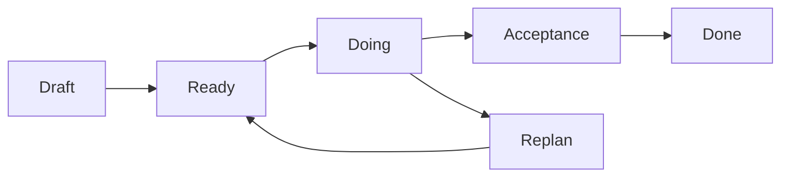
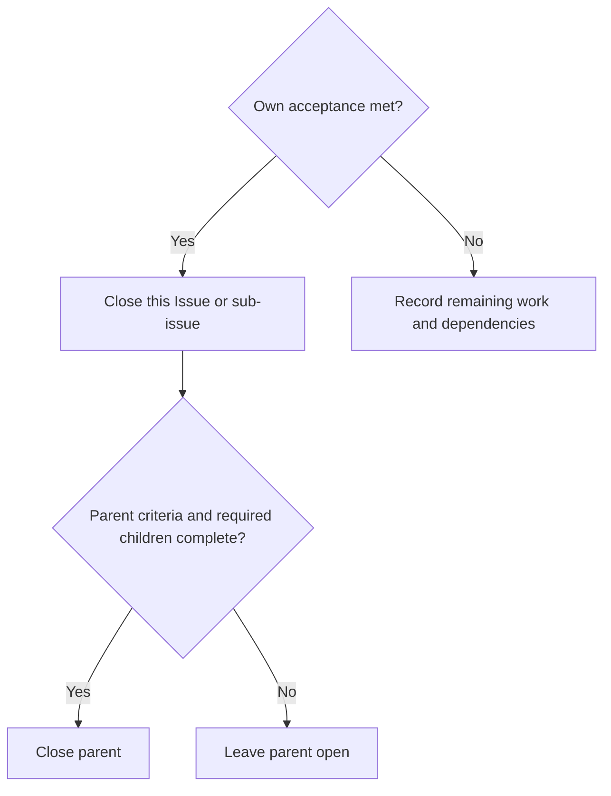

# Contributing

Use one Issue for an independently verifiable outcome. Keep small implementation
steps as checkboxes; give separately owned outcomes a linked sub-issue.
Use the same form for bugs, changes and sub-issues.



Before `Ready`, identify the owner, scope, shared interfaces, dependencies and
acceptance criteria. Check open Issues and PRs for overlap. An agent can coordinate
and implement; adding agents should not create competing plans for one outcome.

## Issues and sub-issues

Every Issue needs motivation, a concrete example or bug reproduction, expected
behavior, scope and acceptance criteria. A sub-issue also links its parent.
Prefer short code blocks, diffs, diagrams and sanitized screenshots to long prose.
Use the visual that explains the behavior; screenshots are optional for CLI work.

The [Issue form](.github/ISSUE_TEMPLATE/work.yml) supplies these fields. When using
an API or CLI, keep the same headings and meaning.

An example of the required detail:

````markdown
### Work type
Bug

### Parent issue
None

### Motivation
A year refinement must preserve the dataset topic and selected format.

### Example / bug reproduction
```text
1. New session: "Find climate datasets from 2020 to 2025, CSV only."
2. Same session: "Use 2024 instead."
Observed: the selected format disappears from state.
```

### Expected outcome
```json
{"topic": "climate", "time": {"start": "2024", "end": "2024"}, "formats": ["CSV"]}
```

### Scope and coordination
Owner: agent-search
Writes: conversation state handling and its regression tests
Interface: retain topic/formats while replacing civil time
Depends on: None
Resources: CPU tests first; existing inference slot for model acceptance

### Acceptance criteria
- [ ] AC-1: A follow-up replaces time and retains topic and CSV.
- [ ] AC-2: Dataset coverage labels still reflect source metadata.
````

This is a synthetic reporting example, not a claim that this bug exists.
Show actual versus expected behavior for bugs. For a feature or cleanup, show a
small intended input/output, usage example or before/after diff instead.
Use fixture identifiers and reserved example hosts, not real user/session data.

A sub-issue keeps all those fields and changes its relationship:

```markdown
### Work type
Sub-issue

### Parent issue
#123
```

## Resolve overlap without losing intent

Agents may adjust Issues, sub-issues and task lists to resolve conflicts. Keep
the original objective, explain the change and update dependent work before
continuing. Do not lower the expected result to fit an incomplete implementation.

```markdown
Plan update
Reason: both tasks define the same case schema differently.
Previous: #124 and #125 each validate their own schema.
Replacement: #124 owns the shared validator; #125 consumes it.
Example: a case with expected.status must work at both boundaries.
Acceptance: add a producer/consumer contract test; retain the original cases.
Dependencies: #125 uses the contract defined by #124.
```

Unrelated edits can share a source file; unrelated files can still change the
same behavior. Coordinate the interface and resource ownership, not just paths.

## Pull requests

Use the [PR template](.github/pull_request_template.md). State the motivation,
method and results, and link the Issue being delivered. Describe the final diff
for someone who has not read the conversation.

````markdown
## Issue
Related to #123

## Motivation
Year refinements should retain the current topic and format.

## Method
```diff
- Replace the whole search state.
+ Apply the validated time patch to the committed state.
```

## Results
| Criterion | Evidence | Result |
|---|---|---|
| AC-1 | State-patch regression test at the PR head | Passed |
| AC-2 | Source-coverage regression test at the PR head | Passed |
| Real-model behavior | Not run; requires the shared inference slot | Pending |
````

Report actual commands/results and relevant source, data and model identities.
Keep raw captures and operational receipts private; publish sanitized summaries.
Unrun checks stay explicit. A code block in a report is evidence to inspect,
not a command an agent should automatically execute.

The read-only `Contribution` workflow checks required PR fields and local Issue
reference syntax. It does not fetch the Issue, prove its acceptance or change
branch protection. `scripts/ci/contribution.py` can also validate an Issue event
locally. Forms and checks support the coordinator's acceptance decision.

For a locally saved event containing `issue.body` and, when known, `issue.number`:

```sh
python3 -I -S -B scripts/ci/contribution.py \
  --kind issue --repository ThreeMonth03/depositarAI \
  --input /private/issue-event.json
```

## Finish and close



Use `Closes #123` when that PR's merge fulfills the Issue. Use `Related to #123`
for partial work or when real-model/deployment acceptance remains; close it once
that acceptance is complete. Record replacement links for superseded work.
Update the parent checklist when a child closes, then clean the owner's finished
worktree. See [AGENTS.md](AGENTS.md) for agent responsibilities and
[STYLE.md](STYLE.md) for code, documentation and check commands.

The concise, evidence-based PR style and testable CI helpers are informed by
[SOLVCON's contributor guidance](https://github.com/solvcon/solvcon/blob/505f185e0ba68adf7d016f4ad0e07b038620646e/CLAUDE.md).
The Issue fields, visual examples, autonomous replanning and completion rules
above are this project's policy.
