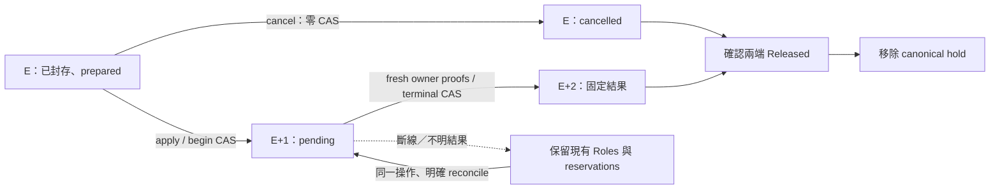

# 後端更新、回退與退休

[`update_search_backend.py`](../../scripts/update_search_backend.py) 協調 GPU 主機的
backend authority／TLS owner，以及前端 VM 的 binding participant。它以一份封存操作
管理兩端的保留狀態，讓中斷後仍能明確確認結果與續清。

## 操作範圍

本流程保留 catalog、共享模型程序、HTTPS origin、ACL、TLS 材料、API key、CA、
frontend env、前端映像與容器實例，只更新 API backend 綁定及當前 checker API pin。
Update／rollback 的 TLS 切換會停止精確舊 pair，再啟動計畫中的 pair，因此可能短暫不可用。

| 操作 | 準備條件 | 成功結果 |
| --- | --- | --- |
| `backend-code-update` | active A／rollback 空；B 已用原 E 與完整 digest 完成候選驗收 | active B／rollback A；B 移交 backend authority |
| `backend-code-rollback` | active B／rollback A；兩份原 authority 與實例仍可驗證 | active A／rollback B；不建立第三個 client |
| `backend-code-retire` | active A／rollback B；維護者明確結束回退窗口 | active A／rollback 空；原 B CPU、專用網路與 runtime lease 已關閉 |

有 rollback 時不能開始下一次 update。先完成受控 retire、確認釋放，再準備下一個候選。
Retire 保留來源、build、模型、catalog、共享網路及原始紀錄；lease 關閉指原 B 的實例與
專用網路已不存在，不撤銷 A/B 可能共用的 catalog 帳號或 key。

## 接管前提

維護者先核對現役映像、source revision、provider authority 與完整 Roles，並完成兩台
主機的新 operator 接管。Git main 的版本不能代替現役身分。

- 所有支援的 frontend、TLS、provider、candidate 與已接管 product writer，均須使用
  同一份已審查、固定 revision 的新 operator，並辨認共同 reservation。
- GPU 端 control／product／catalog／TLS roots，以及 VM 的 delivery／monitor roots，
  必須符合既有擁有者、私有權限與鎖政策。需要管理員處理的 namespace 先完成管理，
  不靠改擁有者、放寬權限或刪 hold 繞過。
- controller 使用已核准的固定 SSH profile，啟動 pinned
  [`participate_backend_binding.py`](../../scripts/participate_backend_binding.py)。
  請求經 stdin 的有限 JSON 協定傳送；不接受任意遠端命令。

GPU 與 VM 各持自己的本機鎖與 durable reservation，沒有跨主機的全域檔案鎖。
這是可信維護帳號間的協作政策；同 UID 直接執行舊 binary 或任意 Docker 命令，
不會因 enrollment marker 而被權限隔離。舊 operator 可保存作歷史，不能並行當 writer。

## 設定如何綁定兩端

設定使用私有 JSON；每個 `path`／`sha256` 都綁定原檔 bytes，修改後須重新核准設定。
`revision` 是完整 Git commit，`entry_sha256` 則是 VM 上實際入口腳本的 digest。
程式同時比對設定中的 source root 與實際載入的 operator，不能拿另一份乾淨 checkout
替目前執行的程式背書。

| 私有設定 | 固定的身分 |
| --- | --- |
| Controller | 本機 operator、control config、SSH profile、核准的 coordinator peer |
| SSH profile | 固定 hops／SSH config、VM operator／入口 digest、participant config、VM peer |
| Participant | VM operator、delivery config、核准的 coordinator peer |
| Enrollment | participant 類型、實際 namespace、operator、原 configuration ref |

Controller 設定的結構如下；大寫字串是待替換的範本值，不能直接執行：

```json
{
  "schema_version": 1,
  "kind": "backend-binding-controller",
  "operator": {
    "root": "/absolute/pinned/operator",
    "revision": "FULL_COMMIT"
  },
  "control_config": {
    "path": "/absolute/private/control.json",
    "sha256": "CONFIG_SHA256"
  },
  "frontend_transport": {
    "path": "/absolute/private/frontend-transport.json",
    "sha256": "TRANSPORT_SHA256"
  },
  "backend_peer_sha256": "APPROVED_COORDINATOR_PEER_SHA256"
}
```

SSH profile 的 `hops` 只接受固定 destination 與可選的私有 `ssh_config` ref，搭配
`participant_source`、`participant_config`、`entry_sha256`、`peer_sha256`。
Participant 設定固定為 `schema_version: 1`、`kind: frontend-binding-participant`，
其餘欄位是 `source`、`delivery_configuration`、`coordinator_peer_sha256`。
來源與 configuration 綁定，不能代替維護者對 peer／SSH 主機身分的獨立核准。

接管時須讓全部支援的 writer 使用新 operator，並由 namespace 的合法 owner 建立
相符 enrollment。工具不自動接管陌生 state、不覆蓋既有 owner，也不代管 SSH 金鑰。

## Epoch 與結果

每次准入同時比對 **完整 Roles epoch 與 canonical SHA256**。E 代表本次封存的原狀態；
數字相同但內容不同也會拒絕。正常操作只寫兩次 Roles：begin 到 E+1，terminal 與清除
pending 合併為 E+2 的一次寫入。Begin 前取消維持 E，零次 Roles 寫入。



`predecessor` 是這一筆操作開始前的完整綁定。它與成功 update 之後另開一筆正常
`backend-code-rollback` 不同。`no-effect` 必須由 owner 證明未 dispatch 且原綁定完整；
只看到 A 仍在執行，不足以證明沒有副作用。已執行後返回原綁定記為 `verified_return`。

Update 在 E+1、尚未 dispatch 時選擇 `no-effect`，會保留原本仍在執行的 candidate B，
以及原 E snapshot／IDs；不能把未移除的實例標為 stopped，也不重綁成 E+2。
其後 start／query 仍受 freshness 檢查拒絕；維護者可使用既有受控 candidate stop，
先做 disposable／ownership 檢查再移除 B。只有真正完成 discard／absence 的
`verified_return` 才會把 current 標為 stopped。E+2 遺失 resolution 時也先重新證明
兩端未 dispatch，才恢復 `no_effect` 分類，不憑 side 推定已回退或已移除 B。

## 準備與套用

從固定 operator source 執行。以下變數代表維護者已獨立核對的私有位置、完整 digest
與當前 epoch；每筆新操作重新取得，不從待採納輸入自行產生信任依據。

```bash
BACKEND_TOOL=/absolute/pinned/operator/scripts/update_search_backend.py
BACKEND_CONFIG=/absolute/private/backend-binding.json

python3 -I -S -B "$BACKEND_TOOL" --config "$BACKEND_CONFIG" prepare \
  --kind backend-code-update \
  --expected-epoch "$BACKEND_EPOCH" \
  --expected-roles-sha256 "$BACKEND_ROLES_SHA" \
  --candidate-profile "$CANDIDATE_PROFILE" \
  --candidate-profile-sha256 "$CANDIDATE_PROFILE_SHA" \
  --target-tls "$TARGET_TLS_PLAN" --target-tls-sha256 "$TARGET_TLS_SHA"
```

Prepare 封存候選原 E／digest、兩端身分與計畫，留下同一操作的 intent／hold／reservations，
尚未切換綁定。保存輸出的 `intent_sha256`、`epoch`、`roles_sha256`，再明確套用：

只有 immutable intent 檔案、尚未成功建立 canonical hold 時，操作還未被接管；
`status`／恢復會在任何 participant reservation 前拒絕。保留該歷史檔案，不手動補 hold。
兩端沒有 reservation 時可由目前的完整 E／digest 重新 prepare；若 TLS 或 VM 留有
reservation，新 prepare 也會在建立新 canonical hold 前拒絕，不能覆蓋舊操作。

```bash
python3 -I -S -B "$BACKEND_TOOL" --config "$BACKEND_CONFIG" apply \
  --intent-sha256 "$BACKEND_INTENT_SHA" \
  --expected-epoch "$BACKEND_EPOCH" \
  --expected-roles-sha256 "$BACKEND_ROLES_SHA" --side target
```

正常 rollback 與 retire 都是新操作，使用新的當前 E／digest，之後沿用上面的 apply：

```bash
python3 -I -S -B "$BACKEND_TOOL" --config "$BACKEND_CONFIG" prepare \
  --kind backend-code-rollback \
  --expected-epoch "$BACKEND_EPOCH" \
  --expected-roles-sha256 "$BACKEND_ROLES_SHA" \
  --target-tls "$TARGET_TLS_PLAN" --target-tls-sha256 "$TARGET_TLS_SHA"

python3 -I -S -B "$BACKEND_TOOL" --config "$BACKEND_CONFIG" prepare \
  --kind backend-code-retire \
  --expected-epoch "$BACKEND_EPOCH" \
  --expected-roles-sha256 "$BACKEND_ROLES_SHA"
```

Retire 的 prepare 明確選擇結束這份 rollback window；工具封存原 rollback B 的精確處置
閉包。Rollback 不帶新 candidate；retire 不帶 candidate 或 target TLS。

## 中斷後先確認，再明確續行

命令中斷或回非零時，保留原 intent 與所有紀錄。先核對該操作目前的完整 Roles，
再以其實際 epoch／digest 查詢；未知身分或 stale snapshot 都不會自動修復。
`BACKEND_SIDE` 依下表明確選擇；E+2 必須沿用原 terminal side。

```bash
python3 -I -S -B "$BACKEND_TOOL" --config "$BACKEND_CONFIG" status \
  --intent-sha256 "$BACKEND_INTENT_SHA" \
  --expected-epoch "$BACKEND_EPOCH" \
  --expected-roles-sha256 "$BACKEND_ROLES_SHA"

python3 -I -S -B "$BACKEND_TOOL" --config "$BACKEND_CONFIG" reconcile \
  --intent-sha256 "$BACKEND_INTENT_SHA" \
  --expected-epoch "$BACKEND_EPOCH" \
  --expected-roles-sha256 "$BACKEND_ROLES_SHA" --side "$BACKEND_SIDE"
```

Side 由維護者依狀態選擇，不能放進自動重試迴圈：

| 目前狀態 | 合法續行 |
| --- | --- |
| E／prepared，尚無取消決定 | `apply` 或 `cancel`；取消保持 E，也保留原 candidate B |
| E／已有取消決定，release 中斷 | 同操作 `cancel` 或 `reconcile`，確認原取消結果與 Released；零 CAS |
| E+1，尚未固定不可逆結果 | 明確 `reconcile --side target` 或合法的 `predecessor`；能證明未 dispatch 才可 `no-effect --side predecessor` |
| E+1，update discard 已封存 | 只准 predecessor；重認 VM 的 decision digest，再按原 IDs 續清 B |
| E+1，retire 已 dispatch | 只准 retire target；依原 IDs／absence 續清，不能重造 B |
| E+2，decision 或 release ACK 遺失 | 同操作 `reconcile` 指定原 terminal side，重核目前實例、補確認與清 hold；不再寫 Roles |
| Released 已持久化，reservation 尚在／ACK 遺失 | 同操作確認原 Released，僅清自己的 reservation；歷史 receipt 不等於目前健康 |

取消使用相同參數，將 action 改為 `cancel`；不要另開 operation 來解除舊操作的 fence。
錯 op、epoch、digest、source、namespace、陌生 peer 或替換 ID，均保留 hold 並停止。
不手動清 pending、不刪 reservation、不自動過期放行。

Update 返回 predecessor 時，**durable discard 決定先於第一個 B 移除，且須正面確認 VM
已固定同一決定**。決定落盤後只能完成 predecessor；B 半停／半刪只在該操作的 cleanup
observer 中接受。沒有 decision 的缺失 B 不會被推定為可清理，也不能重新建立 B 補成原實例。

Released 先持久化，才移除匹配的 reservation。斷線只代表本機連線結束，不代表遠端副作用
已取消。超限仍保留原操作，不提高限制繞過錯誤。

## 每次命令的預算

GPU controller 與 VM participant 各使用自己的 monotonic clock；每次 invocation 最多
1800 秒。重啟或 reconcile 會建立新的 invocation 預算，但仍須使用原 operation、完整
Roles 與最新 owner 證據。這不是跨主機共用時鐘，也不是 reservation 自動到期時間。

| 範圍 | 固定上限 |
| --- | --- |
| Backend invocation | 32768 command credits，含失敗與清理 |
| VM participant invocation | 128 commands，含來源 Git 與 Docker |
| 每個 protocol phase | 8192 credits；prepare／open／begin／release 為 600 秒，terminal／cleanup 為 900 秒 |
| TLS 啟動失敗的實例清理 | 在同一總額內預留 512 credits／120 秒，只供 owned cleanup callback |
| 明確啟用的 catalog 稽核子程序 | 256 commands／最多 120 秒；每次嘗試由 parent 預扣 257 credits，不退款 |

Credits 是保守資源預留，不等於實際建立的程序數或 GPU 秒數。一般 phase 准入須保留
該階段的剩餘上限及 TLS failure cleanup 額度；之後的 phase 可能因此拒絕並保留 hold，
由維護者以同一 operation 明確恢復。Update return／retire 的 protocol cleanup 仍使用
一般 phase，不能動用專供 TLS 啟動失敗的預留額。

稽核子程序共用同一個 explicit runner 計算內部 Git／Docker 等命令。256 可支援固定
來源的正常核對，但不保證所有合法的 16-slot 歷史都完成：多個 slot 到最後一項才不相容
時會安全拒絕，沒有 fallback 或跳過驗證。預設 catalog 稽核呼叫的協定維持原樣。

## 前端歷史與後續維護

本流程只改 current API pin，不改寫 `previous`。若 previous 還指向舊 API，正常的前端
image rollback 會在 Docker mutation 前拒絕不相容組合；不能改歷史 pin 假裝相容。
後續相容的前端 release 才會建立新的 previous。前端映像維護見
[前端交付](FRONTEND_DELIVERY.md)，候選準備見[共用後端](SHARED_BACKEND.md)。

程式與 CPU 故障測試的完成，不代表已完成主機接管、原生 SSH／TLS／GPU 驗收或公眾入口
部署。原 namespace 管理、provider adoption、新 writer enrollment，以及實機 update、
return、rollback、retire 的驗收仍需在核准的維護窗口執行。
