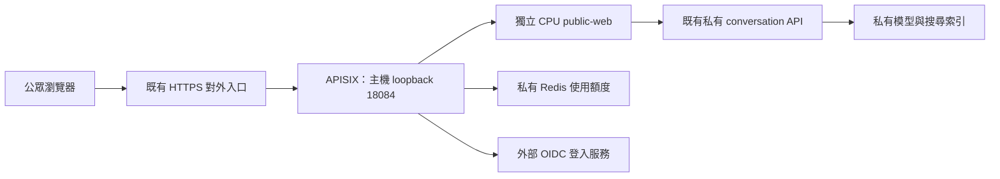

# 公眾入口：登入、使用額度與部署維護

公眾入口是選用的產品服務：首頁與使用說明公開，AI 搜尋需要免費 OIDC 登入。
入口使用 Apache APISIX 與持久化 Redis；專案只補上可信身分與暫時搜尋 session
的銜接，不自行維護密碼、註冊、忘記密碼或 OAuth 協定實作。

這個入口是另一組 CPU 服務，沿用已啟動的私有 conversation API。既有私有試用
`127.0.0.1:18083`、模型、索引與 active release 不因準備入口而切換。
**入口準備完成或離線測試通過，都不等於已對公眾開放**：正式網域、HTTPS 憑證、上游入口
及真實 OIDC client 仍須由部署者配置並驗收。這不是整套產品的新主機 installer。

| 操作者要做的事 | 閱讀位置 |
|---|---|
| 確認登入、配額與網路前提 | [元件與網路邊界](#元件與網路邊界)、[控制範圍與配額語意](#控制範圍與配額語意) |
| 第一次設定與啟動 | [同主機準備與啟動](#同主機準備與啟動) |
| 更新 image、回退或處理中斷 | [更新、回退與中斷恢復](#更新回退與中斷恢復)、[私有版本與狀態](#私有版本與狀態) |
| 檢查可否放行流量或人工暫停 | [驗收與暫停](#驗收與暫停) |

## 元件與網路邊界



APISIX 採檔案設定的 standalone 模式，無需 etcd，停用 Admin API 與 control API。
這些是 [APISIX 部署模式](https://apisix.apache.org/docs/apisix/deployment-modes/)
及開源 [OIDC plugin](https://apisix.apache.org/docs/apisix/plugins/openid-connect/)
提供的功能。採用版本與映像 digest 固定在
[profile.py](../../search/operations/deployment/public_entry/profile.py)。

Redis 使用固定的 8.4.2 映像，選用其 AGPLv3 開源授權；Redis 8 同時提供其他授權
選項，不能把每個 Redis 版本都當作同一授權。
參考 [Redis 授權說明](https://redis.io/legal/licenses/)。

公眾只接觸 HTTPS 對外入口；APISIX 預設僅發布 `127.0.0.1:18084`。
`public-web`、Redis、GPU 服務、OpenSearch、Fess 與管理介面都不發布主機 port。
新的 `public-web` 接入既有 release 的私有 website network，使用該 release 的
conversation API key。它不重啟模型、不重新 embedding，也不修改既有私有網站。

如果前端日後搬到另一台 server，仍應由對外入口把 `/api/*`、`/auth/*` 代理至受保護的
服務，維持同一個網站 origin。單純把畫面移走，不會替 API 增加存取控制。
目前準備工具以同主機的既有 release 為前提，尚未驗收跨機部署。

## 控制範圍與配額語意

| 項目 | 預設與行為 |
|---|---|
| 公開瀏覽 | 首頁、靜態素材與說明可讀；開首頁只查 `/api/access`，不建立搜尋 session |
| AI 搜尋 | `/api/access` 與 session／turn API 驗證登入；未登入回傳 `401 authentication_required` |
| 每個帳號 | 每個 86,400 秒視窗最多 10 次 turn 提交 |
| 公眾入口全站 | 每個 86,400 秒視窗最多 100 次 turn 提交；多帳號仍共用此上限 |
| session 建立 | 每個帳號每 3,600 秒最多 10 次建立；全站最多 100 次建立 |
| 暫存 session | 每個帳號最多 2 個同時存活的搜尋 session；既有 30 分鐘期限與 20 輪上限保留 |
| 請求限速 | 每個可識別來源 IP 每秒 3 次，burst 12；來源 IP 必須由可信代理提供 |
| 計數故障 | Redis 不可用時不降級為無限使用；新的受配額控制請求被拒絕 |

這是從該計數器第一個請求開始的固定視窗，**不是每天午夜重置**。
每人與全站計數器各有自己的視窗起點。登入、重新整理或換 IP 不會重置相同帳號的
配額；帳號鍵來自已驗證的 issuer 與 `sub`，不採信訪客提供的身分標頭。
固定視窗的邊界附近可能接連使用前後兩個視窗的額度，短期併發與逾時限制仍須保留。
計數規則使用 APISIX 的 [limit-count plugin](https://apisix.apache.org/docs/apisix/plugins/limit-count/)。
既有私有試用仍由可信操作者存取，不納入這個公眾入口的計數，也不能再直接代理到外網。

配額計的是 HTTP turn 提交請求，**不是實測 GPU 秒數、模型呼叫數或成功搜尋數**。
請求通過入口計數後，下游驗證錯誤、忙碌、逾時或手動重試可能仍消耗額度；多個
計數規則也不是會自動回滾的交易。第一版採保守計數，不自動補回額度，前端不自動重試。
`quota_exceeded`、`rate_limited`、`session_capacity` 與 `busy` 有各自的使用提示。

Redis 使用私有 bind mount、AOF、`appendfsync always` 與 `noeviction`，讓正常重啟沿用
計數；每次寫入同步到磁碟會增加延遲，仍需保留底層儲存的可靠性。
不可刪除 `redis-data`、執行清空資料或改用空目錄來更新入口，否則配額狀態會遺失。
磁碟損壞、遺失及人為清空仍須有備份／復原安排；持久化不等於異地備援。
參考 [Redis 持久化與 fsync 語意](https://redis.io/docs/latest/operate/oss_and_stack/management/persistence/)。

## 身分、session 與惡意輸入

APISIX 處理 OIDC authorization code flow、state／nonce／PKCE 與安全登入 cookie，並驗證
issuer／audience。小段入口銜接程式只從驗證完成的 claims 取得 issuer 與 `sub`，產生穩定的
雜湊帳號鍵，清除外來身分標頭，再加入受保護的 subject 與入口金鑰。
CPU BFF 的 [identity.py](../../search/web/identity.py) 驗證這兩項資料，將搜尋 session
綁定該帳號；其他帳號即使取得搜尋 token，也不能讀取、使用或刪除這個 session。

OIDC 登入 cookie 與搜尋 session bearer 各自處理；入口會保留 `/api/turn` 的
`Authorization: Bearer <search-session>`，不以 provider token 覆蓋。
前端只將搜尋 token 與對話留在記憶體，不寫入 localStorage／sessionStorage。
登入失效清除搜尋狀態並提示重新登入；搜尋 session 本身失效則提示「新搜尋」。

登入提供穩定的配額歸屬，**不證明是真人，也不防止多帳號、prompt injection 或大量
連線攻擊**。全站上限降低多帳號的運算消耗，原有輸入長度、嚴格 schema、固定上游、
最小索引權限、單一併發與逾時限制繼續提供程式邊界。這些限制不依賴模型遵守指令。

Anubis 尚未整合、打包或預設啟用。它可作為後續提高爬取成本的選用元件，但先要測
登入回跳、手機、輔助工具及誤擋。其[官方政策文件](https://github.com/TecharoHQ/anubis/blob/main/docs/docs/admin/policies.mdx)
也提醒有些機器人能通過挑戰，不能替代配額與全站上限。
大量流量若塞滿對外頻寬，同主機的 APISIX 無法自行解決；正式公開前須確認機構或
上游對外入口的 DDoS 處理能力與聯絡方式。

## 同主機準備與啟動

### 1. 準備外部登入與 HTTPS

沒有可用 SSO 時，可以先註冊 Google 的 **Web application** OAuth client；這是外部
身分服務，並非專案自行架設的開源帳號系統。到 Google Cloud 的 OAuth 設定建立
client，填入應用程式名稱、聯絡資訊與同意畫面，並把公開服務的完整 callback 註冊為：

```text
https://YOUR_PUBLIC_HOST/auth/callback
```

redirect URI 必須與入口設定完全相同，包括 scheme、host、port 與 path。
Google 的 discovery 是 `https://accounts.google.com/.well-known/openid-configuration`，
issuer 是 `https://accounts.google.com`。入口只要求 `openid` scope，使用穩定的 `sub`，
不需要 Google Drive 等 API 權限，也不依賴 email 作帳號鍵。
在測試狀態先加入測試帳號；對公眾推出前，完成 provider 要求的正式發布設定。
參考 [Google OpenID Connect 設定](https://developers.google.com/identity/openid-connect/openid-connect)。

對外 HTTPS 代理必須將網站路徑轉送至 `http://127.0.0.1:18084`，保留登入 cookie 與
`Authorization`，以設定好的 host 轉送；覆寫 `X-Real-IP` 為實際訪客 IP，設定 HTTPS 的
forwarded scheme／port，清除訪客提供的 Forwarded／X-Forwarded 身分資訊。
`trusted_proxy_cidrs` 只填 APISIX 實際看到的代理來源，不能使用 `0.0.0.0/0`。
若空白，入口不信任轉送 IP；所有請求可能共用代理 IP 的限速桶。
實際代理來源可能是 Docker bridge 位址，不能單憑代理的 loopback 目標猜測。

本工具不綁定主機 443、不申請憑證、不修改 DNS 或機構防火牆。
缺少以上條件時只完成私有準備，不宣稱已能安全公開。

### 2. 建立私有設定與 secret files

從 [public-entry.example.json](../../deploy/env/public-entry.example.json) 建立 Git 外的
`/absolute/private/public.json`，填入真實 `public_origin`、client ID、四個 secret file
路徑及 state root。所有路徑使用絕對路徑，不能使用 symlink 或與 repository 重疊；
設定檔與 secret files 應為操作帳號擁有的普通檔案，權限 `0600`（亦接受 `0400`），
其直接父目錄與 state directory 使用 `0700`。四個 secret file 路徑必須彼此不同。
不要將 secret 放進 Git、shell 命令參數、`.env` 範例或文件。

| Secret file 欄位 | 內容 |
|---|---|
| `oidc_client_secret_file` | Provider 發出的 client secret，單行、不含空白的 1–4,096 個可列印 ASCII 字元 |
| `oidc_session_secret_file` | 新產生的 64 個小寫十六進位字元，用於登入 session |
| `edge_secret_file` | 另一組獨立的 64 個小寫十六進位字元，保護入口至 BFF 的身分 |
| `redis_password_file` | 另一組獨立的 64 個小寫十六進位字元，供 Redis ACL 使用 |

三個隨機 secret 可各自使用 Python `secrets.token_hex(32)` 產生，存檔時採 `0600`，
不要列印到日誌或覆寫既有檔案。Provider client secret 另行填入。
`oidc_ca_file` 僅供需要私有 CA 的 provider；未設定時使用映像內建系統 CA，TLS 驗證不關閉。

若 Docker 預設位址池不足，可用選用的 `network_subnets` 明確指定三個小型私有
IPv4 網段；以下只是設定範例：

```json
{
  "network_subnets": {
    "website": "10.253.250.0/28",
    "quota": "10.253.250.16/28",
    "outbound": "10.253.250.32/28"
  }
}
```

使用前確認不與現有 Docker networks、主機路由及機構網段重疊；範例不是已保留的機構
配額。設定支援 `/24` 至 `/28` 的私有 IPv4 網段，三者不可互相重疊。
這個方法不清除既有 networks、不修改 Docker daemon，也不搬動現役 catalog。

### 3. 建置已提交來源的 CPU website image

從已提交且乾淨的來源建置前端與 BFF，記下不可變的 image ID：

```bash
docker build --build-arg SOURCE_REVISION="$(git rev-parse HEAD)" \
  -f deploy/docker/web/Dockerfile -t depositar-public-web:local .
docker image inspect --format '{{.Id}}' depositar-public-web:local
```

準備工具要求 `sha256:<64 hex>` image ID，以及
`io.depositar.ai.public-entry.version=1` 與有效的來源 revision label。
舊版私有網站映像缺少這個能力標記，不能拿來替代新 BFF，避免入口有驗證但後端未綁定身分。
建置包含前端，不下載模型、不重建索引；APISIX／Redis 另使用設定中固定的映像 digest。

### 4. 準備並啟動獨立入口

使用現役 release 的私有 `compose.json`，不是舊 gateway 的 manifest。
這兩個指令使用獨立入口設定，**不需要產品的 `--config`**：

```bash
python3 scripts/depositarai.py prepare-public-entry \
  --entry-config /absolute/private/public.json \
  --release-compose /absolute/private/current-release/compose.json \
  --web-image sha256:YOUR_VERIFIED_64_HEX_IMAGE_ID

python3 scripts/depositarai.py up-public-entry \
  --entry-config /absolute/private/public.json \
  --release-compose /absolute/private/current-release/compose.json \
  --web-image sha256:YOUR_VERIFIED_64_HEX_IMAGE_ID
```

`prepare-public-entry` 驗證私有設定、secret files、release 網路參照與 image label，產生
`STATE_ROOT/public-entry/compose.json`、入口設定與 `prepared.json`，不啟動服務。
CPU website image 須已建置並存在本機；準備不探測私有 backend 的執行狀態，因此可以
先產生設定，再啟動既有私有 release。
相同輸入、相同檔案可以重跑；既有準備內容若不同或被竄改會拒絕覆寫。
準備先寫入私有 staging directory，所有檔案與收據完成後才發布正式目錄；中斷後可
重新準備，遺留 staging 保持私有，不拿它當作已部署內容，也不自動刪除資料。
`up-public-entry` 在同樣驗證後啟動 APISIX、Redis 與新的 CPU `public-web`，等待健康檢查。
現役 conversation API 必須已啟動；工具不會替它啟動 GPU 或切換 release。
首次啟動會先以唯讀 Docker 查詢核對私有後端：指定的 network 必須是該 release 的
internal bridge；其中須有唯一、正在運作且健康的 `conversation-api`，其 project／
service 標記、網路 alias、固定 image 與唯讀 API key 掛載須符合 release 及 website
設定，且沒有 published ports。檢查失敗時不建立公眾容器、不寫入待恢復交易；先修正
私有 backend，再以相同設定重試。已產生的準備素材會保留。
這項預檢不呼叫模型、不啟動 GPU，也不要求 Google provider 連線。
Docker 健康與身分符合仍不等於實際推論驗收。
準備時會將 release project、network 名稱與固定 API image 記錄在
`compose.json` 的 `x-depositar-plan.private_backend`，連同部署素材保存在版本 snapshot。
首次啟動核對的是這份固定身分，不會在準備完成後重新讀取可變的 release 檔案來
改換後端目標；API key 掛載也必須與準備好的 website 設定一致。
第一次啟動要求尚無同名 Compose project，且準備好的 `redis-data` 為空；沒有管理收據的
既有服務或 Redis 資料不會被自動接管。首次部署前先記錄私有版本 snapshot 與交易，
先只建立尚未啟動的 Redis，核對 image、標記、掛載與網路後，將完整 container ID
持久寫入交易，才啟動 Redis 與入口。Redis 使用只啟動既有容器的操作；website 與
入口以 `--no-deps --no-recreate` 啟動，不經依賴展開建立替代 Redis。健康、固定素材
及已記錄 Redis 身分驗證完成後，才發布目前版本。
已有管理收據時，相同有效設定與目前 image 的 `up-public-entry` 只驗證既有三個容器、
image、掛載、網路及健康狀態，不重建已健康的版本。手動停止或被外部修改的服務不會
被當作正常狀態悄悄恢復。
健康檢查僅表示程序與基本 HTTP 可用，回報仍保留 `public_readiness_verified=false`；
不代表真實登入、BFF 的身分阻擋、上游模型或公眾網路已完成驗收。
首次啟動失敗可能留下部分 CPU 容器與待恢復交易；先檢查回報，再依下一節使用
`recover-public-entry`，不要反覆執行普通啟動、刪除 Redis 資料或改用空目錄。

## 更新、回退與中斷恢復

這組生命週期指令只更換獨立 CPU `public-web` 的 image，讓前端與 BFF 可以一起更新。
它固定有效入口設定、部署素材、secret 內容與參照路徑、網路、既有私有 backend，以及
APISIX／Redis image。變更網域、OIDC client／金鑰、配額、網段或私有 release 仍須另行
設計並驗收遷移；不能藉普通 app 更新一併修改。

| 指令 | 必要參數 | 行為 |
|---|---|---|
| `update-public-entry` | `--entry-config`、`--release-compose`、`--web-image` | 驗證固定條件後更換 CPU website image；相同 image 為唯讀驗證 |
| `rollback-public-entry` | `--entry-config` | 回到記錄的前一個已完成版本，不接受臨時指定其他 image |
| `recover-public-entry` | `--entry-config` | 處理待恢復交易；有舊版本時回到交易前版本，首次部署則完成已記錄的 bootstrap |

這些指令同樣不使用產品的 `--config`。先依前面的建置方式取得新 image ID，再執行：

```bash
python3 scripts/depositarai.py update-public-entry \
  --entry-config /absolute/private/public.json \
  --release-compose /absolute/private/current-release/compose.json \
  --web-image sha256:YOUR_NEW_VERIFIED_64_HEX_IMAGE_ID

python3 scripts/depositarai.py rollback-public-entry \
  --entry-config /absolute/private/public.json

python3 scripts/depositarai.py recover-public-entry \
  --entry-config /absolute/private/public.json
```

三個範例分別用於更新、主動回退與故障恢復，不是每次更新後都依序執行。
候選與回退 image 必須已在本機，符合相同 capability／來源 revision 要求；更換 website
時不 build 或 pull image，也不啟動 GPU。保留所有仍需回退版本的舊 image，不能只保留
snapshot 便刪除映像。

每次變更先驗證記錄與目前容器一致，取得獨占操作鎖，寫入待完成交易；停止
`public-entry` 後只替換 `public-web`，再以 `start --wait` 啟動**同一個**入口容器。
成功前會確認 APISIX 與 Redis container ID 未改變。Redis 不被重建，沿用相同資料目錄
與配額命名空間，不主動清空計數；配額視窗仍按實際時間到期。
過程中公眾入口短暫中斷；既有 `18083` 私有試用、模型與索引不在本次更新範圍。

普通啟動、更新及回退在變更前會核對版本所記錄的私有 backend；替換 website 後、
重新開啟入口前與發布版本前還會再驗證。自動回退及 `recover-public-entry` 也受相同
檢查約束。交易開始前的驗證失敗會拒絕變更，不更動既有服務。已有待恢復交易時，
若後端停止、不健康或身分變動，交易會保留，入口盡力保持停止；
不能因 website 或 Redis 仍健康就發布成功。先恢復原本的私有 backend，再執行 recover，
不必清空交易或 Redis。停止是否成功仍以回報的 `entrance_stopped` 為準。

`public-web` 重建會清除 RAM 中的搜尋 session。已開啟的瀏覽器下一輪可能收到 `410`，
需要「新搜尋」；登入 cookie 留在瀏覽器，由同一個 APISIX 驗證，OIDC 金鑰未變且
登入未到期時仍可使用。回退 app 也不會恢復舊的 RAM 搜尋 session。

### 私有版本與狀態

`STATE_ROOT/public-entry/` 保留原始準備素材，並新增：

- `versions/<generation>/compose.json` 與 `snapshot.json`：不可覆寫的版本資料與素材／
  secret 雜湊，不包含 secret 原文；新版本先完整 staging 再發布，部分寫入不會成為
  可使用版本，中斷後可重試。
- `active.json`：目前版本、前一個版本、實際 container ID 與有效素材的識別資料。
- `transaction.json`：變更開始前寫入的交易，記錄候選與交易前版本；成功發布後才移除。
  首次 bootstrap 另記錄 `quota_container_id`：`null` 表示尚未核定配額容器，完整 ID
  表示入口啟動前已持久記錄的 Redis 身分，不會依目前查到的容器偷偷改寫。
  若程序在發布 `active.json` 後、移除交易前中斷，仍須先恢復交易，不能只看 active 檔
  就認定變更已完成。

以上目錄維持 `0700`、檔案 `0600`，不要手動改寫或刪除狀態檔來解除保護。
回退或恢復會重驗素材、secret 與 image；同一路徑的 secret 內容改變也會拒絕普通更新。
沒有可信 `active.json`／待恢復交易的舊 runtime 或 Redis 資料不會被自動採用，避免
把未知狀態當作可清空重裝的入口。
舊 profile 若缺少 `x-depositar-plan.private_backend`，或記錄格式不合法，同樣拒絕
啟動、更新與恢復；不自動補寫、接管或重置既有配額資料。若已有待完成交易，恢復
失敗會保留記錄並嘗試關閉入口；應先確認並修復原始部署素材，不要手動編造後端身分。

| 回報 `status` | CLI exit | 操作者處理 |
|---|---|---|
| `public_entry_started`／`public_entry_updated`／`public_entry_rolled_back` | `0` | 記錄目前 generation；只代表受控入口服務操作完成 |
| `public_entry_unchanged` | `0` | 目前版本已符合請求，未替換容器 |
| `public_entry_recovered` | `0` | 已恢復交易前版本，或完成首次 bootstrap；再做實際服務驗收 |
| `update_failed_rolled_back` | `1` | 要求的版本切換失敗、已自動恢復原版本；不能當作更新／回退成功，先查原因 |
| `recovery_required` | `1` | 自動回退失敗或首次部署未完成；保留交易，阻擋後續普通變更，使用恢復指令 |

遇到待完成交易時，普通 `up`、update 與 rollback 會拒絕並回報
`public_entry_pending_operation`。`recover-public-entry` 有交易前版本時一律恢復那個版本，
不繼續發布候選；首次 bootstrap 沒有舊版本，才以已記錄設定及 `--no-recreate` 完成
部署，保留已存在的入口與已核定 Redis 容器。尚未核定 Redis 的早期中斷，只有在沒有
website／入口容器、資料目錄為空，且 Redis 尚未建立或可證明仍從未啟動時，才允許
繼續建立及記錄身分。已記錄 ID 後，即使同一資料目錄仍存在，缺失或換 ID 的 Redis
也不能被普通 recover 重建或接管；保留交易與資料，另行處理經驗證的修復或遷移。
缺少 `quota_container_id` 的舊 bootstrap 交易會拒絕恢復並嘗試關閉入口，不從執行中
容器補猜身分。沒有待完成交易時，recover 只驗證目前版本。

Redis 使用相同資料掛載與 AOF 保存配額；更換容器本身不等於計數歸零。上述身分保護
防止恢復流程在缺少證據時接受替代配額服務，不會雜湊持續變動的 AOF、清空資料或
提供自動配額重置。

`recovery_required` 會依固定的 Compose project／service 標記，盡力停止公眾入口並再查
確認沒有執行中的入口容器。即使待恢復交易、歷史 snapshot 或 secret 損壞，也不依賴
那些檔案執行停止；損壞的交易原文會保留，無法確認的版本欄位回報 `null`。
這仍需要可讀的私有入口設定與安全的 state root，以取得操作鎖；無法定位或鎖定狀態時
指令會拒絕操作，不能據此認定入口已停止。
只有回報 `entrance_stopped=true` 才表示已確認停止；若 Docker 失聯或停止失敗而回報
`false`，**不能宣稱入口已停止接受請求**。

| 故障狀態 | 處理方式 |
|---|---|
| `public_entry_pending_operation` | 保留交易與 Redis，使用 `recover-public-entry`；不要反覆執行普通啟動或更新。 |
| 待恢復交易期間，私有 backend 停止、不健康或身分不符 | 先恢復原本 backend，再執行 recover；不改換目標或清空交易。 |
| 已記錄 ID 的 Redis 缺失／換 ID，或 bootstrap 身分紀錄不合法 | 保留交易與資料，安排經驗證的修復或遷移；普通 recover 不建立替代配額服務。 |
| 有待恢復交易，但交易、snapshot 或 secret 損壞 | 保留原文；recover 會盡力依固定 project／service 關閉入口，修復原始素材後再處理。 |
| `entrance_stopped=false` 或無法定位／鎖定 state | 入口停止未獲確認；先停用上游 HTTPS 代理轉送，再恢復 Docker 控制與原有素材。 |

不要用新 state root、刪除 Redis 資料或手動清空交易來繞過故障；需要回退的舊 image
仍須保留。

所有成功與失敗回報的 `public_readiness_verified` 仍為 `false`：版本切換、程序健康及
自動回退不等於真實 Google 登入、正式網域／憑證及對外防護已驗收。

APISIX 配額 key 也包含 `limit-count` 設定的版本雜湊；更改配額、視窗或 Redis 憑證等
設定可能建立新的計數命名空間。相同設定的重啟會沿用配額，任意修改設定則沒有這項
保證；本組 image-only 指令因此拒絕這些變更。需要調整時另行驗收遷移流程，不能以
刪除 state 或另開空 state 目錄重置配額。

## 驗收與暫停

正式放行流量前，透過真實 HTTPS host 驗證完整登入、callback、登出，確認未登入、
偽造身分、超額與其他帳號的 session 都不會到達模型。再驗證入口與 Redis 重啟後，
已用配額仍保留；Redis 故障時 AI 請求被拒絕。CPU fixture 與 mock provider 測試
只驗證程式行為，不代表 Google 真實登入或正式對外網路已驗收。

觀察與暫停使用新入口自己的 manifest：

```bash
docker compose -f /absolute/private/public-state/public-entry/compose.json ps
docker compose -f /absolute/private/public-state/public-entry/compose.json logs --tail 100
docker compose -f /absolute/private/public-state/public-entry/compose.json stop public-entry
```

停止 `public-entry` 會同時停止這個公眾入口的頁面與新 AI 請求，不會停止原本的
`18083` 私有試用或刪除 Redis 資料。此工具不自動改寫機構 HTTPS 代理設定。
手動暫停後，普通更新不會自行恢復這個非健康基準；解除暫停前先確認目前版本及停止
原因。若仍有待恢復交易，先執行 recover；單純人工暫停且沒有待恢復交易時，才使用
`active.json` 記錄的 `compose_file` 啟動既有 `public-entry` 容器。
不要直接對原始 `compose.json` 執行 `up` 或強制重建；一般變更使用上面的生命週期指令。
需要調整配額或加入反爬挑戰服務時，依實際等待時間、拒絕率與模型成本另行設計及
驗收；普通 image-only 更新不包含這些設定遷移。
