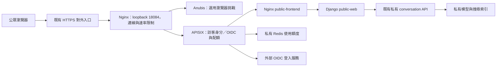

# 公眾入口：登入、使用額度與部署維護

公眾入口提供兩種模式：`mixed` 讓訪客小額試用、登入者取得較多額度；
`login_required` 維持必須登入的行為。既有設定未指定模式時仍為 `login_required`。
新範例採 `mixed`，並啟用選用的 Anubis 挑戰。登入使用 APISIX OIDC，計數使用
APISIX 原生 limit-count 與持久化 Redis；專案只實作身分與搜尋 session 的銜接、
設定渲染及錯誤提示，不自行維護密碼、OAuth 協定或另一套額度資料庫。

這個入口是另一組 CPU 服務，沿用已啟動的私有 conversation API。既有私有試用
`127.0.0.1:18083`、模型、索引與 active release 不因準備入口而切換。
**入口準備完成或離線測試通過，都不等於已對公眾開放**：正式網域、HTTPS 憑證、上游入口
及真實 OIDC client 仍須由部署者配置並驗收。這不是整套產品的新主機 installer。

| 操作者要做的事 | 閱讀位置 |
|---|---|
| 確認登入、配額與網路前提 | [元件與網路邊界](#元件與網路邊界)、[控制範圍與配額語意](#控制範圍與配額語意) |
| 第一次設定與啟動 | [同主機準備與啟動](#同主機準備與啟動) |
| 更新或回退網站版本 | [更新與人工回退](#更新與人工回退)、[私有版本與狀態](#私有版本與狀態) |
| 檢查可否放行流量或人工暫停 | [驗收與暫停](#驗收與暫停) |

## 元件與網路邊界



APISIX 採檔案設定的 standalone 模式，無需 etcd，停用 Admin API 與 control API。
這些是 [APISIX 部署模式](https://apisix.apache.org/docs/apisix/deployment-modes/)
及開源 [OIDC plugin](https://apisix.apache.org/docs/apisix/plugins/openid-connect/)
提供的功能。採用版本與映像 digest 固定在
[profile.py](../../search/operations/deployment/public_entry/profile.py)。

Redis 使用固定的 8.4.2 映像，選用其 AGPLv3 開源授權；Redis 8 同時提供其他授權
選項，不能把每個 Redis 版本都當作同一授權。
參考 [Redis 授權說明](https://redis.io/legal/licenses/)。

公眾只接觸 HTTPS 對外入口；啟用防爬時僅外層 Nginx 發布 `127.0.0.1:18084`，
APISIX 與 Anubis 不發布主機 port；未啟用時由 APISIX 發布同一 loopback port。
若關閉 `antibot_enabled`，該外層限速也不建立；這個模式只適合私有試用，或已由外部
HTTPS 代理提供登入前的全站／IP 速率與連線限制。APISIX 自己的 access 階段限速在 OIDC
之後，不能代替登入前的防護。
防爬、外層 Nginx 與 APISIX 共用獨立的 `antibot-gateway` 私有網路；APISIX 只信任
該網路中的 `public-edge` 主機提供的來源 IP。外層只信任明確設定的 HTTPS 代理。
`public-web`、Redis、GPU 服務、OpenSearch、Fess 與管理介面都不發布主機 port。
新的 `public-web` 接入既有 release 的私有 website network，使用該 release 的
conversation API key。它不重啟模型、不重新 embedding，也不修改既有私有網站。

如果前端日後搬到另一台 server，仍應由對外入口把 `/api/*`、`/auth/*` 代理至受保護的
服務，維持同一個網站 origin。單純把畫面移走，不會替 API 增加存取控制。
同主機使用 `--release-compose`；前端與後端分機時，使用下方的
[`--backend-config` 流程](#跨主機準備與啟動)。兩個選項互斥，不會因遠端驗證失敗
而切回本機 Docker network。兩種流程仍須各自完成真實部署環境驗收。

## 控制範圍與配額語意

| 項目 | 預設與行為 |
|---|---|
| 公開瀏覽 | 首頁、靜態素材與說明可讀；開首頁只查 `/api/access`，不建立搜尋 session |
| AI 搜尋 | 同一組 `/api/session`、`/api/turn`；混合模式允許 guest 或已驗證 user |
| 每個訪客 | 每個視窗最多 3 次 turn；使用獨立加密 cookie，非 IP 或瀏覽器指紋 |
| 每個帳號 | 每個視窗最多 10 次 turn；使用驗證後的 issuer + sub |
| 訪客共用／登入者共用 | 每個視窗分別最多 20／80 次，第一版不互相借用 |
| 公眾入口全站 | 每個視窗最多 100 次；同一條 turn 路由共用全站計數器 |
| session 建立 | 每個身分每 3,600 秒最多 10 次建立；全站最多 100 次建立 |
| 暫存 session | 每個身分最多 2 個同時存活的搜尋 session；30 分鐘期限與 20 輪上限保留 |
| 請求限速 | APISIX 每來源 IP 每秒 3 次、burst 12；防爬外層另有全站／IP 連線和速率限制 |
| 計數故障 | Redis 不可用時拒絕受配額控制的請求，沒有無限使用的降級路徑 |

上述額度是初始範例，可由單一設定檔調整。設定必須滿足訪客個人額度低於帳號額度、
各個人額度不大於對應共用池、兩個池相加不超過全站額度。
視窗依 Unix epoch 對齊：預設 86,400 秒，即 UTC 午夜（台灣 08:00）重置。
各規則共用相同 period，剩餘秒數作為原生計數器 TTL，不會因新帳號或池的第一個請求
產生不同重置時間。固定視窗交界仍可能接連使用前後兩窗額度，短期限速及後端併發上限繼續保留。

換 IP、重設搜尋或重新登入不重置相同身分的配額。訪客 cookie 可被刪除，Google 帳號也
可能大量建立，因此它們都不代表唯一真人；共用池與全站上限才是限制總提交量的邊界。
既有私有試用仍限可信操作者，不能直接代理至外網來繞過公眾入口。
計數規則使用 APISIX 的 [limit-count plugin](https://apisix.apache.org/docs/apisix/plugins/limit-count/)。

配額計的是 HTTP turn 提交請求，**不是實測 GPU 秒數、模型呼叫數或成功搜尋數**。
請求通過入口計數後，下游驗證錯誤、忙碌、逾時或手動重試可能仍消耗額度；多個
計數規則也不是會自動回滾的交易。第一版採保守計數，不自動補回額度，前端不自動重試。
混合模式的 turn 錯誤分成 `guest_quota_exceeded`、`user_quota_exceeded`、
`pool_quota_exceeded`、`global_quota_exceeded`；只有訪客個人額度用完提示可登入。
小型回應 adapter 僅轉換原生 limit-count 的確定拒絕回應，不改計數，不把 BFF 的 `busy`
或 session 容量錯誤誤判為配額。等待時間為提示，前端不自動重送。

Redis 使用私有 bind mount、AOF、`appendfsync always` 與 `noeviction`，讓正常重啟沿用
計數；每次寫入同步到磁碟會增加延遲，仍需保留底層儲存的可靠性。
不可刪除 `redis-data`、執行清空資料或改用空目錄來更新入口，否則配額狀態會遺失。
磁碟損壞、遺失及人為清空仍須有備份／復原安排；持久化不等於異地備援。
參考 [Redis 持久化與 fsync 語意](https://redis.io/docs/latest/operate/oss_and_stack/management/persistence/)。

## 身分、session 與惡意輸入

APISIX 處理 OIDC authorization code flow、state／nonce／PKCE 與安全登入 cookie，並驗證
issuer／audience。小段入口銜接程式只從驗證完成的 claims 取得 issuer 與 `sub`，產生穩定的
雜湊帳號鍵，清除外來身分標頭，再加入受保護的 subject 與入口金鑰。
訪客使用 lua-resty-session 的獨立加密 `__Host-depositar-guest` cookie；採安全亂數身分、
Secure／HttpOnly／SameSite=Lax，與登入 cookie 分開。CPU BFF 的
[identity.py](../../search/web/identity.py) 同時驗證入口金鑰、身分類型、subject 與額度描述，
將搜尋 session 綁定 `guest:<id>` 或 `user:<id>`。公眾模式不接受空 owner；
其他身分即使取得搜尋 token，也不能讀取、使用或刪除該 session。

OIDC 登入 cookie 與搜尋 session bearer 各自處理；入口會保留 `/api/turn` 的
`Authorization: Bearer <search-session>`，不以 provider token 覆蓋。
前端只將搜尋 token 與對話留在記憶體，不寫入 localStorage／sessionStorage。
登入、登出或其他分頁造成身分改變時，前端清除舊搜尋狀態並建立新對話，不移交原 token。
登入失效會拒絕請求，不靜默降回訪客沿用舊對話；搜尋 session 本身失效則提示「新搜尋」。
`GET /api/access` 回傳明確的 mode、principal、登入／登出路徑與額度政策，查詢不消耗額度；
它不是剩餘額度查帳端點。

登入提供穩定的配額歸屬，**不證明是真人，也不防止多帳號、prompt injection 或大量
連線攻擊**。全站上限降低多帳號的運算消耗，原有輸入長度、嚴格 schema、固定上游、
最小索引權限、單一併發與逾時限制繼續提供程式邊界。這些限制不依賴模型遵守指令。

選用 Anubis 固定在 v1.28.1 與映像 digest，採 bbolt 持久化、獨立簽署金鑰及有限 CPU／記憶體。
外層 Nginx 對 session 建立與 turn 呼叫執行 auth_request；尚未通過或挑戰過期時，API
只回 `403 challenge_required` JSON，不把驗證 HTML 塞入搜尋回應。瀏覽器由明確的
`/verify` 新分頁完成挑戰後回首頁，原分頁保留問題與結果，必須由使用者再次提交。
登入入口也先驗證；OIDC callback 與登出保留原本的 state／nonce 處理。
Anubis cookie 過期不會自動重播 POST。登入成功不會跳過挑戰與總量控制。

PoW 只能提高自動抓取成本，不能保證擋住分散式爬蟲或證明是真人。
參考固定版本的 [Anubis 政策文件](https://github.com/TecharoHQ/anubis/blob/v1.28.1/docs/docs/admin/policies.mdx)。
大量流量若塞滿對外頻寬，本機容器無法自行解決；正式公開前仍需確認機構或上游
HTTPS 入口的流量保護與聯絡方式。

## 同主機準備與啟動

### 1. 準備外部登入與 HTTPS

沒有可用 SSO 時，可以先註冊 Google 的 **Web application** OAuth client；這是外部
身分服務，並非專案自行架設的開源帳號系統。到 Google Cloud 的 OAuth 設定建立
client，填入應用程式名稱、聯絡資訊與同意畫面，並把公開服務的完整 callback 註冊為：

```text
https://YOUR_PUBLIC_HOST/auth/callback
```

redirect URI 必須與入口設定完全相同，包括 scheme、host、port 與 path。
Google 的 discovery 是 `https://accounts.google.com/.well-known/openid-configuration`，
issuer 是 `https://accounts.google.com`。入口只要求 `openid` scope，使用穩定的 `sub`，
不需要 Google Drive 等 API 權限，也不依賴 email 作帳號鍵。
Google 的 Testing 清單不能作本產品的邀請名單：只要求 `openid`／email／profile
時有測試名單限制的例外。仍不公開的階段使用現有防火牆、VPN 或 SSH 私有入口；
不要以 Google Testing 當存取控制。參考 [Google Audience 規則](https://support.google.com/cloud/answer/15549945?hl=en)。
對公眾推出前，完成 provider 要求的正式發布設定。
參考 [Google OpenID Connect 設定](https://developers.google.com/identity/openid-connect/openid-connect)。

對外 HTTPS 代理必須將網站路徑轉送至 `http://127.0.0.1:18084`，保留登入 cookie 與
`Authorization`，以設定好的 host 轉送；覆寫 `X-Real-IP` 為實際訪客 IP，設定 HTTPS 的
forwarded scheme／port，清除訪客提供的 Forwarded／X-Forwarded 身分資訊。
`trusted_proxy_cidrs` 只填 APISIX 實際看到的代理來源，不能使用 `0.0.0.0/0`。
若空白，入口不信任轉送 IP；所有請求可能共用代理 IP 的限速桶。
實際代理來源可能是 Docker bridge 位址，不能單憑代理的 loopback 目標猜測。

本工具不綁定主機 443、不申請憑證、不修改 DNS 或機構防火牆。
缺少以上條件時只完成私有準備，不宣稱已能安全公開。

### 2. 建立私有設定與 secret files

從 [public-entry.example.json](../../deploy/env/public-entry.example.json) 建立 Git 外的
`/absolute/private/public.json`，填入真實 `public_origin`、client ID、secret file
路徑及 state root。所有路徑使用絕對路徑，不能使用 symlink 或與 repository 重疊；
設定檔與 secret files 應為操作帳號擁有的普通檔案，權限 `0600`（亦接受 `0400`），
其直接父目錄與 state directory 使用 `0700`。所有 secret file 路徑必須彼此不同。
不要將 secret 放進 Git、shell 命令參數、`.env` 範例或文件。

| Secret file 欄位 | 內容 |
|---|---|
| `oidc_client_secret_file` | Provider 發出的 client secret，單行、不含空白的 1–4,096 個可列印 ASCII 字元 |
| `oidc_session_secret_file` | 新產生的 64 個小寫十六進位字元，用於登入 session |
| `edge_secret_file` | 另一組獨立的 64 個小寫十六進位字元，保護入口至 BFF 的身分 |
| `redis_password_file` | 另一組獨立的 64 個小寫十六進位字元，供 Redis ACL 使用 |
| `guest_session_secret_file` | 混合模式必要；獨立的 64 個小寫十六進位字元，供訪客 cookie 加密 |
| `antibot_signing_key_file` | 啟用防爬時必要；獨立的 64 個小寫十六進位字元，供 Anubis Ed25519 seed |

各個隨機 secret 可各自使用 Python `secrets.token_hex(32)` 產生，存檔時採 `0600`，
不要列印到日誌或覆寫既有檔案。Provider client secret 另行填入。
`oidc_ca_file` 僅供需要私有 CA 的 provider；未設定時使用映像內建系統 CA，TLS 驗證不關閉。

若 Docker 預設位址池不足，可用選用的 `network_subnets` 明確指定小型私有
IPv4 網段；以下只是設定範例：

```json
{
  "network_subnets": {
    "website": "10.253.250.0/28",
    "quota": "10.253.250.16/28",
    "outbound": "10.253.250.32/28",
    "antibot-gateway": "10.253.250.48/28"
  }
}
```

使用前確認不與現有 Docker networks、主機路由及機構網段重疊；範例不是已保留的機構
配額。設定支援 `/24` 至 `/28` 的私有 IPv4 網段，各網段不可互相重疊；`antibot-gateway` 僅在啟用防爬時使用。
這個方法不清除既有 networks、不修改 Docker daemon，也不搬動現役 catalog。

### 3. 建置同一版本的前端與 BFF

網站由兩個映像組成：`web-nginx` 內含 React 靜態檔；`web` 提供 Django BFF。
兩者使用同一個已提交的 Git revision，共同構成一版網站；不分開發布或猜測 mutable tag。

```bash
revision="$(git rev-parse HEAD)"
for role in web web-nginx; do
  git archive "$revision" | docker build \
    --build-arg "SOURCE_REVISION=$revision" \
    -f "deploy/docker/$role/Dockerfile" -t "depositar-public-$role:$revision" -
done
docker image inspect --format '{{.Id}}' "depositar-public-web:$revision"
docker image inspect --format '{{.Id}}' "depositar-public-web-nginx:$revision"
```

記下兩個 `sha256:<64 hex>` image ID。BFF 必須有
`io.depositar.ai.public-entry.version=2`；前端必須同時有該版本 2 與
`io.depositar.ai.frontend.version=1`，兩者來源 revision label 必須相同。
舊 BFF／前端的 access 契約不相容，不混用映像；已封存的舊入口需另行安排設定遷移。
這些建置不下載模型、不重建索引。

### 4. 準備並啟動入口

使用既有私有 release 的 `compose.json`。入口設定獨立於產品 `--config`：

```bash
python3 scripts/depositarai.py prepare-public-entry \
  --entry-config /absolute/private/public.json \
  --release-compose /absolute/private/release/compose.json \
  --web-image sha256:YOUR_BFF_IMAGE_ID \
  --web-nginx-image sha256:YOUR_FRONTEND_IMAGE_ID

python3 scripts/depositarai.py up-public-entry \
  --entry-config /absolute/private/public.json \
  --release-compose /absolute/private/release/compose.json \
  --web-image sha256:YOUR_BFF_IMAGE_ID \
  --web-nginx-image sha256:YOUR_FRONTEND_IMAGE_ID
```

準備命令只驗證映像與設定、產生 Compose，不啟動服務。啟動前會核對私有 backend
仍在指定的內部 network、健康、使用指定映像與 API key，且沒有對外發布 port。
第一次啟動拒絕接管既有同 project 容器或非空 Redis／Anubis 資料目錄。

Compose 負責建立 APISIX、Redis、Nginx 與 BFF。Nginx 只連入口的 `website` network，
沒有 API key、edge secret、GPU 或私有 backend network。BFF 在此網路使用 `web`
alias，另經指定的私有 release network 呼叫 conversation API。
APISIX 仍處理所有公開路由的登入、配額、身分清理與限速，再送往 Nginx。

## 跨主機準備與啟動

在前端 VM 執行相同的入口命令，以私有設定取代 GPU 主機上的 release Compose。
網頁、BFF、APISIX、Anubis 與 Redis 留在前端 VM；只有 BFF 經固定 HTTPS origin
連往核准的後端。瀏覽器仍只使用網站自己的 `/api/*`、`/auth/*`，不持有服務 API key。
不將 GPU Docker network 跨主機延伸，也不修改 GPU 主機的防火牆或服務。

前置條件：

- 前端 VM 的 host 與 BFF 容器都能解析並連到核准的 HTTPS 後端；來源須符合既有白名單。
- 已獨立取得後端的可信 API revision、catalog manifest、API key 與 CA 公開憑證。
  CA 私鑰留在後端，前端不需要它。API key 與 CA 複本皆放入操作帳號擁有的
  `0700` 私有目錄，檔案使用 `0400`／`0600`，不放進 Git。
- 後端 `/v1/version` 回傳整數 `conversation_contract_version: 4`。
  第 4 版卡片必須提供 `temporal_coverage` 與 `resource_context`；不接受第 1、2、3 版。
  舊版 API 不符合時，先協調 API／BFF 遷移，不停用這項檢查。
- BFF 映像另有 `io.depositar.ai.conversation.version=4`，其餘網站 image pair
  規則與上方相同。保留真實 HTTPS／OIDC 的前置設定與驗收。

將 [遠端 backend 範例](../../deploy/env/public-backend.example.json) 複製到
Git 外的私有目錄，填入核准的 HTTPS origin、預期身分及檔案路徑。origin 不含 path、
query、userinfo 或 fragment。設定檔本身使用 `0600`，直接父目錄使用 `0700`。

```bash
python3 scripts/depositarai.py prepare-public-entry \
  --entry-config /absolute/private/public.json \
  --backend-config /absolute/private/backend.json \
  --web-image sha256:YOUR_BFF_IMAGE_ID \
  --web-nginx-image sha256:YOUR_FRONTEND_IMAGE_ID

python3 scripts/depositarai.py up-public-entry \
  --entry-config /absolute/private/public.json \
  --backend-config /absolute/private/backend.json \
  --web-image sha256:YOUR_BFF_IMAGE_ID \
  --web-nginx-image sha256:YOUR_FRONTEND_IMAGE_ID
```

準備命令不連後端、不啟動服務。啟用及切版前，受限的主機端 probe 先核對 TLS、
匿名 version 回 401、帶 key 回 200，以及 API revision／manifest／契約版本。
BFF 啟動後再從實際容器內做同一檢查，通過才放行入口；probe 只 GET `/v1/version`，
不呼叫 `/readyz` 或 `/v1/turn`，不重新下載模型或建立索引。
HTTP redirect、錯誤 CA／hostname、逾時、回應過大或身分不符都會拒絕。

跨機 `public-web` 只連 `website` 與可出站的 `outbound` network，不加入
`existing-release`；靜態前端不取得 key、CA 或後端 network。
遠端 origin、預期 API／catalog 身分及 key／CA 內容一併封存，網站更新／回退不允許
順便改這些資料。後端遷移需另建候選設定與 state，再驗收切換，不改寫舊部署證據。

隔離 CPU 測試使用假的 HTTPS API／OIDC，不代表已完成前端 VM 到真實 GPU API 的
搜尋驗收。正式切換前仍須驗證真實搜尋、追問、配額、防爬、登入及人工回退。

## 更新與人工回退

第一版接受短暫維護中斷。更新會先關閉外層 Nginx（若啟用）與 APISIX 入口，再以 Compose 更新 Nginx/BFF
這兩個服務，等待 BFF 與前端首頁健康後重開入口，再檢查 loopback 首頁、health 與 JS／CSS 素材。
更新保留 Redis 與 Anubis 持久化資料，也不更新私有 API、catalog 或 GPU 服務。
跨機更新使用同一個 `--backend-config` 取代 `--release-compose`；回退直接使用
已封存的 remote binding，不重新選擇後端。
APISIX 在啟動時解析 `public-edge` 的可信來源 IP；若自行重建外層容器，需隨後重啟
APISIX。正常部署工具會先啟動外層、再啟動 APISIX，維護時使用同一組工具。
搜尋 session 留在 BFF 記憶體，網站更新或回退後需要重新搜尋；OIDC 與配額另由入口保存。

```bash
python3 scripts/depositarai.py update-public-entry \
  --entry-config /absolute/private/public.json \
  --release-compose /absolute/private/release/compose.json \
  --web-image sha256:YOUR_NEW_BFF_IMAGE_ID \
  --web-nginx-image sha256:YOUR_NEW_FRONTEND_IMAGE_ID

python3 scripts/depositarai.py rollback-public-entry \
  --entry-config /absolute/private/public.json
```

更新僅允許網站映像與 revision 改變。OIDC、配額、Redis、secret 或私有 backend
設定若有變更，先安排獨立維護；不要把它混成網站更新。以相同版本執行
`update-public-entry` 只核對設定、私有 backend 與 HTTP，不重建網站服務。
首次部署後重跑 `up-public-entry` 仍可能暫停入口並重新執行同一組 Compose，保留 Redis；
不要將它當成無變更的狀態查詢。回退選擇先前保存的整組映像，不允許只換回其中一個。

更新失敗回報 `deployment_failed`、退出碼 1，工具會盡力停止入口，**不自動回退**。
先查看 Compose 狀態與已保存的 `pending.json`，確認私有 backend 和磁碟正常，再執行
上面的人工 rollback。若工具無法成功送出停止命令，回報的
`entrance_stop_requested` 為 false，需由維護者立即確認對外入口已停止。

程序被強制終止後可能留下部分已更新的容器；Compose 更新本來就不是跨容器交易。
保留 `pending.json` 與所有版本資料，人工 rollback 會選擇這次更新前的版本。
不提供自動 recovery 或自動接管未知容器。首次啟動沒有前版可回退時，先修正故障，再以相同設定與兩個 image ID
重新執行 `up-public-entry`。它只接受已封存的同一個候選版本，Redis 使用
`--no-recreate` 保留原容器與資料；不接受趁重試更換映像或 secret。不要刪除
Redis 資料來重試。

## 私有版本與狀態

`state_root/public-entry/` 中的設定與版本資料都是私有檔案，不上傳 Git：

| 路徑 | 用途 |
|---|---|
| `compose.json`、`prepared.json`、入口配置 | 初始固定拓樸與配置的核對基準 |
| `versions/<generation>/compose.json`、`snapshot.json` | 一版網站的 Git revision、兩個 immutable image ID、Compose 與設定 digest |
| `active.json` | 最近成功完成 HTTP 檢查的版本及其前版 |
| `pending.json` | 尚未完成的候選版本及更新前版本；供人工回退選版 |
| `redis-data/` | 配額持久化資料；更新與回退保留原目錄 |
| `antibot-data/` | Anubis bbolt 資料；啟用防爬時建立，更新與回退保留 |

部署命令使用同一把檔案鎖，防止兩個維護程序同時更新。版本資料可核對設定及來源，
不能取代線上狀態觀察；磁碟或設定損壞時先停止入口與調查，不修改 digest 假裝成功。
保留可回退的映像與版本檔，不要只刪其中一項。

## 驗收與暫停

loopback HTTP 檢查不代替正式 HTTPS/OIDC 驗收。開放流量前，從真正的外網入口檢查：

- 首頁、JavaScript、CSS 與圖片能載入，瀏覽器沒有 CSP 或 MIME 錯誤。
- 訪客可用小額搜尋，個人配額用完有登入提示；登入、callback、登出與重新登入正常。
- 訪客池耗盡仍保留登入者池；共用池耗盡不誤導使用者登入。
- 未通過挑戰時 session／turn 回 JSON，`/verify` 能完成挑戰，原問題只在明確重試時再送出。
- 以新來源 IP、刪除訪客 cookie 及多帳號驗證，仍不能突破配置的池與全站總量。
- 搜尋、追問、重設與帳號間 session 隔離正常。
- 額度用完、Redis 不可用、私有 backend 異常時，不會放行無限 AI 請求。
- 只公開核准的 HTTPS 入口，沒有旁路可直接存取私有網站或管理介面。

需要人工暫停時，使用目前版本的 Compose：

```bash
docker compose -f /absolute/private/public-entry/versions/GENERATION/compose.json \
  stop public-edge public-entry
```

未啟用防爬時省略 `public-edge`。停止入口不刪除 Redis、Anubis 或版本資料。恢復之前先處理失敗原因；有 pending 版本時，
優先執行人工 rollback。不要使用 `down -v`、清空 Redis 或重建空的資料目錄。

## 程式邊界與離線驗證

- `public_entry/identity.py`／`identity.lua`：將驗證過的登入 claims 或訪客 cookie 轉為可信 principal。
- `public_entry/quota.py`：唯一額度規則渲染；計數與原子寫入交給 APISIX／Redis。
- `public_entry/quota_response.lua`：將確定的原生配額拒絕轉成前端錯誤碼。
- `public_entry/antibot.py` 與模板：防爬服務與外層代理設定。
- `search/web/identity.py`／`sessions.py`：BFF 信任邊界與對話 owner；不維護另一份額度。
- `web/src/api.ts`／`search/session.ts`／`search-access.tsx`：型別化契約、身分切換與明確恢復操作。

現有 CPU 測試可驗證真實 APISIX／Redis／假 OIDC provider 與 Anubis；所有測試服務
使用獨立 Compose project、私有網路、不發布主機 port、不載入模型。瀏覽器整合使用
模擬搜尋上游。這些測試不取代真實 Google client、正式 HTTPS、手機與機構入口驗收。
